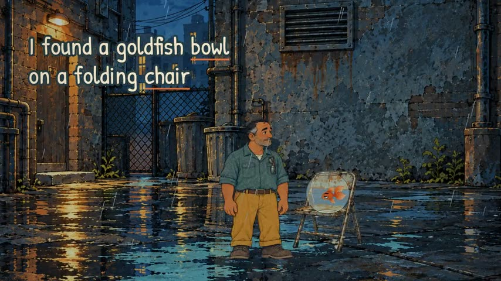
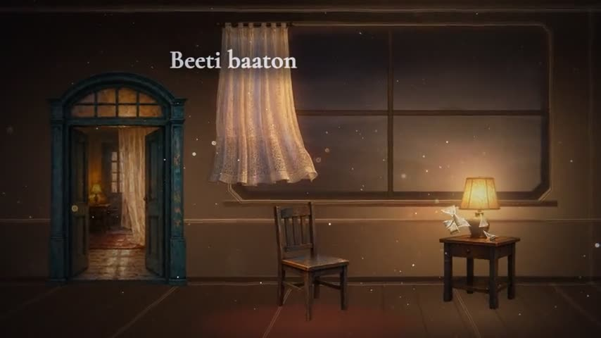
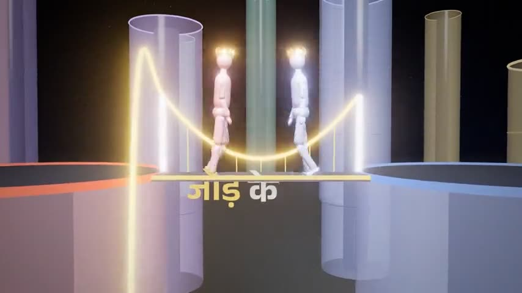
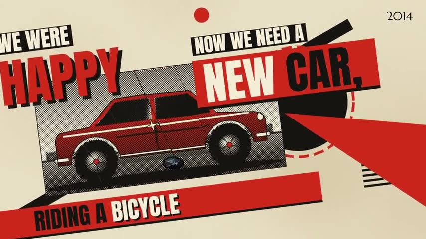

# video-director

A Claude Code plugin that directs music videos in code. It also edits talking-head reels and YouTube videos.

It grew out of five films made with Claude Code: a p5.js cut-out comedy, a Hindi ballad in Remotion and WebGL, a Hindi rap built by seven parallel agents in three.js, an art-history piece that walks through famous paintings, and a Himalayan mist piece. Each one cost several revisions. The lessons from those revisions are now rules and checks in this plugin.

| | | |
|---|---|---|
|  |  |  |
| Painterly cut-out (p5.js) | Cinematic plate (Remotion + WebGL) | Clay world (three.js) |
|  |  | |
| Pop era collage (Canvas + three.js) | Mist silhouette (three.js) | |

Watch two of them in full: [Jod Ke Dekh](https://www.youtube.com/watch?v=19mDcggGr7I) and [Basement Goldfish](https://www.youtube.com/watch?v=vVhuyxakG-k).

## Install

In Claude Code:

```
/plugin marketplace add BuzyOwl/song-video-director
/plugin install video-director@buzyowl
```

Then say "make a music video for this song" and attach the mp3. You need Python 3.10+, Node 22+ and ffmpeg. On first run the skill runs `scripts/doctor.py` and prints the one command for anything missing.

Point heavy temp files at a big drive. One render once filled a C: drive with 7.8 GB of Chrome profiles:

```
VD_TMP=D:\video-director\tmp
VD_MODELS=D:\video-director\models
```

## How a video gets made

1. You pick a look from a gallery of real clips (`skills/video-director/gallery/index.html`), or paste links to work you love.
2. Claude asks five questions in one message. Every question has a default and "go" accepts them all.
3. A router sends each scene to the lightest engine that can hold the look and prints the cost before anything runs. HyperFrames for type and graphics, Remotion for 2.5D story films, three.js when the world itself is the story, AI clips only where realism is the point.
4. For a song, `song_facts.py` measures the tempo, beat grid, energy and word timings first. Nothing is timed by guess.
5. A grey-box animatic of the whole song gets approved before any art is built.
6. Three stills are scored on a 100 point rubric. A fresh subagent that never saw the code scores them again and the lower score counts, because self-scores ran about 10 points high when huashu-art-motion measured them.
7. `film_gate.py` fails a render that freezes for over a second or flickers. It also reports cut rate per section and how far the palette drifted from the brief.

## Realism without losing control

AI video drifts on camera paths and choreography. So the plugin blocks the shot out in Blender first, through mcp-for-blender. That fixes the lens, the camera path keyed to the beat, and real scale. The clay render then guides the AI clip as first and last frames, a depth pass or a motion reference.

For dance, a reference clip goes through motion transfer (Higgsfield), or through FreeMoCap into a rigged character when you need exact choreography and your own camera. Credits are never spent until you approve a shot table with the cost on it.

You can also hand it a real clip and get it rebuilt as a 3D scene (method adapted from MattVidPro's video-to-unreal), then move the camera through it in ways the original never could.

## What is inside

| Path | What it is |
|---|---|
| `skills/video-director/SKILL.md` | the hub: front door, router, rules, feedback loop |
| `modes/` | music, talking (the full talking-head pipeline), youtube |
| `engines/` | code, ai-clip, guide-3d, recreate |
| `references/` | feel bands per genre and mood, style protocol and rubric, lessons, verified free sources and MCPs |
| `styles/` | five looks, each a spec another agent can build from |
| `scripts/` | song_facts, film_gate (with tests), doctor, make_samples |
| `evals/` | 29 routing and feel evals, and a blind A/B taste test for releases |

Claude reads the hub, one mode and at most two engines per job, about 330 lines. Everything else loads only when a step names it.

## Credits

Built on ideas from [claude-video-2](https://github.com/ItsssssJack/claude-video-2) (gallery-first flow, brief in numbers), [huashu-art-motion](https://github.com/alchaincyf/huashu-art-motion) (style protocol, rubric, explainer grammars, anti-slideshow gate; MIT), [MVP-Prompts](https://github.com/mattvideoproductions/MVP-Prompts) (video-to-unreal, Seedance prompting guide) and gokaygokay's video-to-shader method. Full list with licenses in `CREDITS.md`.

If you only need timed lyrics on a background, [hookline.cc](https://hookline.cc) does that in minutes.

MIT licensed. If it helped, a star helps other people find it.
